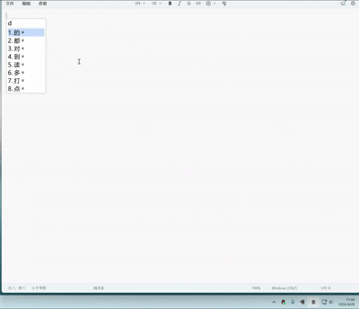
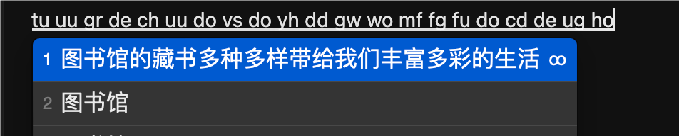
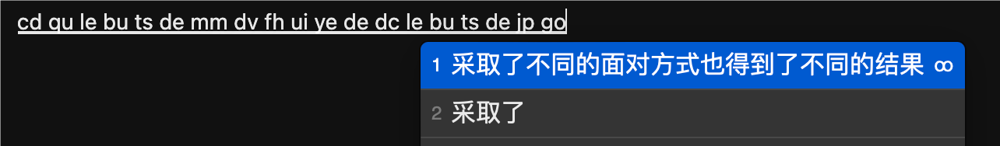
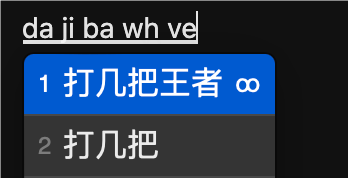

# 白霜拼音

白露凝烟绕玉堂，霜华浸月映回廊。拼将清景藏诗里，音绕庭轩岁月长。

原始配置和词库由[雾凇拼音](https://github.com/iDvel/rime-ice)的 [af2480b](https://github.com/iDvel/rime-ice/commit/af2480ba1b147a6a54c0c21e2997ef451c34e036) commit 修改而来。

雾凇词库主要的问题是字频和词频不太对，废词有点多，于是重新制作。[相关讨论](https://github.com/iDvel/rime-ice/issues/902)

主要维护词库、词频。在雾凇词库的基础上删除了不健康词汇，删除了大量冷僻词（频率==1 且分词器分不出的词），删除/调整了诸如“的吧”、“的了”这种不是词的词。手动大量修改了字频 词频。第一步是做了减法。

然后使用 745396750 字的高质量语料，进行分词，重新统计字频、词频，归一化，以达到更好的输入效果。全拼和双拼都可以使用。

根据最新评测结果（生成时间: 2026-04-25 16:49:02 +08:00），[白霜拼音](https://github.com/gaboolic/rime-frost)在不使用模型和使用相同模型的评测上，均取得最佳效果，同时也超越商业输入法（关闭云拼音）。参见评测：

[查看rime各方案评测结果](https://github.com/gaboolic/rime-schema-compare/blob/main/report/latest.md)

[查看其他windows输入法评测结果](https://github.com/gaboolic/rime-schema-compare/blob/main/report/other_latest.md)

评测的代码也是开源的，可复现。

现在推出了windows端独立输入法，可安装[墨奇输入法](https://github.com/gaboolic/moqi-im-windows)，自带白霜拼音作为默认方案。

### 使用方法

使用方法基本同雾凇拼音，微调了一些触发指令，加入了 lua 辅助码的支持。辅助码是可选项，按下 `` ` `` 开启，不影响正常打字。

默认方案是全拼，可以切换输入方案，也支持自然码双拼、小鹤双拼、微软双拼、搜狗双拼等双拼方案。

- 符号 /fh 更多符号详见 <https://github.com/gaboolic/rime-frost/blob/master/symbols_v.yaml>
- 带调韵母 /a /e /u 等
- 日期与时间 rq sj xq dt ts
- 开启句中任意辅助码 ` 使用说明：[句中任意辅助码](/lua/aux_lookup_filter.lua)  拆分说明：[墨奇辅助码拆分说明](https://moqiyinxing.chunqiujinjing.com/index/mo-qi-yin-xing-shuo-ming/fu-zhu-ma-shuo-ming/mo-qi-ma-chai-fen-shuo-ming)
  
- **逐字辅筛**：先打完整拼音，再按两次反引号。比如输入 ``` liyi``w ```，选「立」后不立即上屏；直接按 `c` 再选「艺」，最后一起上屏「立艺」。每字可加一到两位辅码，退格先删辅码，再退出逐字模式。单反引号的整句辅筛不变。
- 部件拆字反查 uU
- unicode字符 U
- 数字金额大写 R
- 农历 N
- 计算器 V

如需改逐字引导键，在对应方案的 `*.custom.yaml` 中加入以下补丁（已有 `patch:` 时合并到里面）：

```yaml
patch:
  "frost_aux_filter/char_trigger": "`~"
```

重新部署后用反引号加波浪号进入逐字模式。首键须是能进入当前组字缓冲的标点（默认可用反引号）。设为 `""` 可禁用逐字模式，不影响单反引号。

### 十四键全拼

重新部署后，在方案选单中选择 **白霜十四键**（`rime_frost_14key`）。按全拼逐字母输入，同一组的字母共用一个键。方案复用白霜全拼词库，候选注释显示实际拼音，便于区分同码候选。例如 `bugao` 可选「你好」，`zu'ab` 可选「西安」。ASCII 单引号 `'` 可显式分隔音节，不确认候选或上屏。

| 前端按键标签 | 发送给 Rime 的 ASCII 键码 |
| --- | --- |
| `QW ER TY UI OP` | `q e t u o` |
| `AS DF GH JK L` | `a d g j l` |
| `ZX CV BN M` | `z c b m` |
| 分词 | `'` |

**前端集成：** 键盘由前端绘制，直接发送表中的键码，不需要在前端枚举拼音。原始输入是键码，预编辑可能显示 Rime 自动插入的音节间隔；候选注释可用来显示该候选的实际拼音。方案不继承二十六键的英文混输、拆字反查和辅码触发器。如已自定义 `schema_list`，追加 `- schema: rime_frost_14key` 后重新部署。

### 十四键双拼

自然码和小鹤双拼也可以使用上表的键位。重新部署后，分别选择 **白霜自然码双拼·十四键**（`rime_frost_double_pinyin_14key`）或 **白霜小鹤双拼·十四键**（`rime_frost_double_pinyin_flypy_14key`）。每个音节仍用两键；例如「你好」在自然码下按 `BN UI GH JK`，在小鹤下按 `BN UI GH CV`。两个方案分别复用原双拼拼写规则与白霜词库，保留候选的实际拼音注释和单引号分词，与原二十六键方案并存。

在 Linux 上安装 C++ 编译器和 librime 开发包后，可运行 `bash others/test/frost_14key_smoke.sh` 检查十四键全拼和两种双拼。

### 九宫格笔画

重新部署后，在方案选单中选择 **九宫格笔画**（`rime_frost_stroke_t9`）。按笔顺输入：横/提 `h`、竖 `s`、撇 `p`、点/捺 `n`、折 `z`。例如 `szhs` → 中，`nhpn` → 文，也可以只输前几笔再选字。

- **通配** (`x`)：每字最多用一个通配符，代替任意一笔。例如 `sxhs` 可以找出「中」。
- **分词** (`'`)：确认当前候选并继续输入下一字，不立即上屏，也不插入撇号。最后选择候选可一次上屏。方案不自动切分未分词的笔画串。

**前端集成：** 需要支持 `Component.Translator` 的 librime-lua。共享数据目录需保留 `rime_frost_stroke_t9.schema.yaml`、`stroke.dict.yaml`、`essay.txt`、`default.yaml` 及 `lua/moqi_stroke.lua` 的原有相对路径。若自定义 `schema_list`，追加 `- schema: rime_frost_stroke_t9` 后重新部署。九宫格由前端绘制，前端应发送上述 ASCII 键，而不是按键上的笔画字符。

笔画码表沿用仓库原有数据，来源和整理者见 [`stroke.dict.yaml`](stroke.dict.yaml) 文件头；[Rime 五笔画上游](https://github.com/rime/rime-stroke) 采用 LGPL-3.0。重新分发时保留码表的来源声明及适用的许可证。

在 Linux 上安装 C++ 编译器和 librime 开发包后，可运行 `bash others/test/frost_stroke_smoke.sh`，在临时目录部署方案并检查笔画输入、前缀候选、退格和选字上屏。

### 如何安装&配置文件路径

#### 手动下载安装

下载本仓库的压缩包 Code - Download ZIP（或者下载 [releases](https://github.com/gaboolic/rime-frost/releases) 最新的 source-code.zip），解压到如下路径即可

- Windows:
  - 安装[墨奇输入法windows版](https://github.com/gaboolic/moqi-im-windows)的自带方案。Rime配置文件夹在：`%APPDATA%\Moqi\Rime` （可以在右下角输入法右键打开菜单选用户文件夹）
  - 小狼毫：`%APPDATA%\Rime` （可以在右下角小狼毫输入法右键打开菜单选用户文件夹）复制完之后，去输入法设定里选择白霜拼音，然后重新部署
  - 注：%APPDATA% 路径实际为 C:\Users\<USER>\AppData\Roaming
- Mac
  - [鼠须管](https://github.com/rime/squirrel)路径为 `~/Library/Rime`
  - [fcitx5-Mac 版](https://github.com/fcitx-contrib/fcitx5-macos)路径为 `~/.local/share/fcitx5/rime`
- Linux
  - [fcitx5-rime](https://github.com/fcitx/fcitx5-rime)路径为 `~/.local/share/fcitx5/rime`
  - fcitx5 flatpak 版的路径 `~/.var/app/org.fcitx.Fcitx5/data/fcitx5/rime`
  - [ibus-rime](https://github.com/rime/ibus-rime)路径为 `~/.config/ibus/rime`
- Android
  - 安装[墨奇输入法安卓版](https://github.com/gaboolic/moqi-im-android)的自带方案。（可以输入法设置页面打开菜单输入zip下载链接来下载）白霜拼音nightly下载链接：<https://github.com/gaboolic/rime-frost/releases/download/nightly/rime-frost-schemas.zip> （有问题时再用最新release下载链接：<https://github.com/gaboolic/rime-frost/releases/latest/download/rime-frost-schemas.zip>）支持九键、二十六键、语音输入
  - [fcitx5-安卓版](https://github.com/fcitx5-android/fcitx5-android)路径为 `/Android/data/org.fcitx.fcitx5.android/files/data/rime`
  - [同文](https://github.com/osfans/trime)路径为 `/rime`
- iOS
  - [仓输入法](https://github.com/imfuxiao/Hamster)目前已内置，也可以通过【输入方案设置 - 右上角加号 - 方案下载 - 覆盖并部署】来更新白霜拼音。
  - [元书输入法](https://ihsiao.com/apps/hamster/v3/docs/) 白霜拼音nightly下载链接：<https://github.com/gaboolic/rime-frost/releases/download/nightly/rime-frost-schemas.zip> （有问题时再用最新release下载链接：<https://github.com/gaboolic/rime-frost/releases/latest/download/rime-frost-schemas.zip>）

#### 通过 Git 安装

**首次安装：**

根据用户使用的系统、安装的软件不同，先 cd 到对应的配置文件的父级目录(例如 Windows 为 `%APPDATA%`、mac 鼠须管为 `~/Library/`)，然后执行以下命令：

`git clone --depth 1 https://github.com/gaboolic/rime-frost Rime`

**后续更新：**

在 Rime 文件夹执行 `git pull` 即可。

- Mac: `cd ~/Library/Rime && git pull`
- Windows: `cd "$env:APPDATA\Rime" && git pull`
- 其他系统以此类推

#### 通过 东风破 安装

选择配方（others/recipes/*.recipe.yaml）来进行安装或更新：

- ℞ 安装或更新全部文件 执行 `bash rime-install gaboolic/rime-frost:others/recipes/full`

如果旧的双拼补丁在 `melt_eng.custom.yaml` 或 `radical_pinyin.custom.yaml` 中引用各自的 `*.schema.yaml:/algebra_…`，更新后可分别将引用改为 `melt_eng_algebra:/algebra_…` 和 `radical_pinyin_algebra:/algebra_…`，保留原来的规则名，再重新部署。

### 无智能模型时的输入效果










### 多整句、句中任意辅助码


### 不同方案整句效果对比

可以运行 <https://github.com/gaboolic/rime-schema-compare> 来对比各个拼音方案

[查看最新评测结果](https://github.com/gaboolic/rime-schema-compare/blob/main/report/latest.md)

### 语言模型

语言模型说明见 [rime-octagram-data.txt](others/语言模型相关/rime-octagram-data.txt)

修改 rime_frost.custom.yaml，添加：

```yaml
patch:
  grammar:
    language: xxxx
    non_collocation_penalty: -4
    collocation_max_length: 5
    collocation_min_length: 2
    collocation_penalty: -14
  translator/contextual_suggestions: true
  translator/max_homophones: 4
  translator/max_homographs: 2
```

(不想修改rime_frost.custom.yaml 可以下载模型把本项目里的zh-moqi替换掉)

模型从如下地址可以获取：

- [八股文、s1、fcitx5等模型](https://github.com/rimeinn/octagram-data)
- [墨奇模型](https://github.com/gaboolic/rime-build-grammar)
- [万象模型](https://github.com/amzxyz/RIME-LMDG/releases/tag/LTS)

### 鸣谢

雾凇词库 <https://github.com/iDvel/rime-ice> 白霜词库的初始词库、绝大部分配置来自雾凇词库

结巴中文分词 <https://github.com/fxsjy/jieba>

汉字转拼音(pypinyin) <https://github.com/mozillazg/python-pinyin>

MNBVC 超大规模中文语料集 <https://github.com/esbatmop/MNBVC> 目前已有 33TB 数据量

kenlm <https://github.com/kpu/kenlm> 官网<https://kheafield.com/code/kenlm/>

kenlm 教程、python 调用 <https://github.com/mattzheng/py-kenlm-model>

吉祥物(于2024-10-12捡来)：


### 友情链接

使用白霜词库的方案

墨奇输入法windows版 <https://github.com/gaboolic/moqi-im-windows>

墨奇输入法android版 <https://github.com/gaboolic/moqi-im-android>

墨奇音形 <https://github.com/gaboolic/rime-shuangpin-fuzhuma>

墨奇五笔整句 <https://github.com/gaboolic/rime-wubi-sentence>

薄荷拼音 <https://github.com/Mintimate/oh-my-rime>

雨燕输入法 <https://github.com/gurecn/YuyanIme> 一个开箱即用的安卓输入法

### 赞助

如果觉得项目不错，可以支持一下。[赞助](https://www.chunqiujinjing.com/donate/)


### Star History

[](https://star-history.dera.page/#gaboolic/rime-frost&Date)
